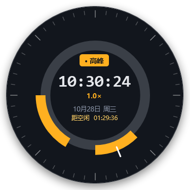

# DeepSeek 时段挂件

> Windows 桌面小挂件：一眼看清现在是 DeepSeek 的「高峰时段」还是「空闲时段」，以及还有多久切换。23 套界面可切换，只依赖 Windows 自带的 PowerShell 5.1 + WPF，**无第三方依赖**。
>
> 非 DeepSeek 官方项目。

[](https://github.com/ChenChen913/deepseek-time-widget/actions/workflows/test.yml)
[](LICENSE)
[](#快速开始)

<p align="center">
  
  
</p>
<p align="center">
  
  
</p>

> 四张图分别是高峰、工作日夜晚、周末、法定节假日下默认界面的实际渲染结果，不是网页设计稿。

## 功能

- **实时状态**：每秒刷新；高峰 / 空闲 / 周末 / 法定节假日分别有自己的状态文案与配色
- **北京时间**：始终按 UTC+8 计算，与本机时区无关；显示日期、星期和法定节假日名称
- **两种时间口径**：
  - 默认界面、A1、A5、B1、B3、B5 底部是 **当天 00:00–24:00** 的时段轴：两个高峰窗口用状态色标出，白线是当前时刻，午夜归零
  - E2 / E2B 的 8 段 HUD 条按 **当前这一段** 计算：周五 18:00 到周一 09:00 是同一段空闲，跨周末连续，不会在周六、周日零点重置
- **切换倒计时**：自动跨过午休、夜间、周末和法定节假日，跨天显示「N天 HH:MM:SS」
- **23 套界面**：卡片右键「界面方案」随时切换，选中即生效并写入 `settings.json`，不用重启；其中 8 套共用通用卡片骨架，其余 15 套由 13 套专属模板渲染
- **单实例**：重复启动不会开第二个窗口，而是把已在运行的挂件叫到前台
- **托盘图标**：左键单击显示 / 隐藏挂件；右键打开深色 HUD 菜单，可置顶、开关开机自启、退出
- **右键菜单**：卡片右键是自绘圆角玻璃面板，托盘右键是同风格深色面板，均替代系统默认菜单
- **开机自启**：卡片或托盘菜单勾选即可，切换时不弹提示
- **节假日数据**：内置 2025、2026 年中国法定节假日（共 61 天），支持右键联网更新
- **无依赖**：只需 Windows 10 / 11 自带的 Windows PowerShell 5.1

## 界面

默认界面是深色玻璃卡片。右键「界面方案」里列出的 23 套，都是挂件里真实可切换的布局，不存在「网页里有、程序里没有」的方案。

下面 4 张是其中一部分的实际运行截图（统一拍在高峰态）：

| A1 · 极简折射流光 | C4 · 圆表 |
| --- | --- |
|  |  |
| **E2B · 中文余量 HUD** | **F1 · 峰谷示波器** |
|  |  |

> 23 张方案截图都在 `design/previews/scheme-*.png`，由 `tools/capture-schemes.ps1` 调用挂件自身的离屏渲染生成，统一拍在同一时刻（2026-10-28 10:30:24 周三高峰）。所以各方案的时钟数字相同——这是同一时刻的真实渲染，不是占位图。

| 分组 | 方案与窗口尺寸 |
| --- | --- |
| 默认 | 默认界面（316 宽，高度自适应） |
| A | A1 316 / A3 516×140 / A5 316 / A6 326×326 |
| B | B1 344×208 / B3 500×130 / B4 320×320 / B5 344×208 |
| C | C1 344×208 / C2 344×208 / C3 480×132 / C4 320×320 / C6 304×184 |
| D | D1 344×208 / D3 340×204 / D6 324×194 |
| E | E2 314×189 / E2B 334×202 / E3 314×189 / E4 330×175 / E5 315×180 |
| F | F1 304×226 |

尺寸里的「316」表示宽度 316、高度由布局自适应。

### 关于 design/ 目录

`design/` 里保留的是开发过程中的视觉评审稿：`design-options*.html`、`all-schemes.html`、`code*.html`、`live-v1-states.html`。它们都是网页草图，**不是挂件的实际界面**；部分方案没有落地，颜色、圆角、排版也可能与最终 WPF 实现不同。

- 实际界面以运行中的挂件和 `design/previews/scheme-*.png` 为准
- 旧版在线预览 `design/design-options.html` 是 2026-10-28 的 6 方向稿，已不代表当前版本；README 不再提供它的在线预览入口
- `design/all-schemes.html` 是当时的 25 方案评审台存档，只用于追溯设计过程

## 计费规则（来自 DeepSeek 官网）

> 空闲时段价格为高峰时段价格的一半。北京时间周一至周五（不含中国法定节假日）9:00 - 12:00、14:00 - 18:00 为高峰时段；其余时段，包括周末及中国法定节假日全天均为空闲时段。

挂件的实现约定：

| 项目 | 规则 |
| --- | --- |
| 高峰时段 | 北京时间周一至周五 09:00-12:00、14:00-18:00（不含法定节假日） |
| 空闲时段 | 其余所有时间，包括周末、法定节假日全天，价格 = 高峰的一半 |
| 分钟边界 | 09:00:00 进入高峰；12:00:00 进入空闲；14:00:00 进入高峰；18:00:00 进入空闲 |
| 调休 | 严格按官网字面规则：周末即使遇到“调休上班日”也按空闲时段处理 |
| 时区 | 始终按北京时间（UTC+8）计算，与本机系统时区无关 |

## 快速开始

**方式一：下载即用（推荐）**

到 [Releases](https://github.com/ChenChen913/deepseek-time-widget/releases/latest) 下载 `DeepSeekClock-v*.zip`，解压到任意固定目录，双击 **`启动挂件.vbs`** 即可。解压后请保持文件夹结构完整。

**方式二：从源码运行**

1. 克隆或下载本仓库；
2. 双击 **`启动挂件.vbs`**（静默启动）；如果系统禁用 VBScript，可双击 **`启动挂件.cmd`**；
3. 挂件会出现在屏幕右下角，左键拖动可移动；卡片右键打开完整菜单（界面方案 / 置顶 / 开机自启 / 更新节假日数据 / 退出）。托盘图标左键显示 / 隐藏，右键打开快捷菜单（显示 / 隐藏、置顶、自启、退出）。

要求：Windows 10 / 11，无需安装任何运行时。

## 节假日数据与更新

- 内置 `holidays.json`：**2025 年 28 天、2026 年 33 天**放假日（来源：国务院办公厅节假日安排通知，并与 timor.tech、NateScarlet/holiday-cn 逐日交叉核对）；
- 右键「联网更新节假日数据」会抓取当年 + 次年数据并合并（保留旧年份和 `makeupWorkdays` 等字段，自动备份 `.bak`）；日常运行不联网；
- 更新结果写入 `%APPDATA%\DeepSeekClock\holidays.json`，启动时优先读取它，因此程序放在 `Program Files` 等只读目录也能正常更新；
- 2027 年安排截至 2026-10-30 尚未发布；数据缺失时挂件自动降级为“只看星期几”，并在日期行提示「数据待更新」；
- 也可手动编辑 `holidays.json`。

## 文件结构

```
├─ 启动挂件.vbs            # 静默启动器
├─ 启动挂件.cmd            # 备用启动器
├─ DeepSeekClock.ps1       # 主程序（WPF 界面 + 交互）
├─ holidays.json           # 节假日数据
├─ lib/
│  ├─ DeepSeekTime.ps1     # 时段判断核心逻辑（纯函数）
│  ├─ Schemes.ps1          # 界面方案引擎：23 份配方 + 3 套通用布局 + 15 个装饰器
│  └─ SchemesPro.ps1       # 13 套专属布局（A3/B3 胶囊、A6/B4 表盘、C3 刻度带、示波器/液晶/瑞士分屏/野兽派/半谷/K线/色块/HUD/圆表）+ 9 个专属装饰器
├─ test/
│  ├─ Test-Core.ps1        # 单元测试（79 项断言）
│  └─ Test-Schemes.ps1     # 界面方案数据校验（872 项断言）
├─ tools/
│  ├─ make-icon.ps1        # 重新生成图标
│  ├─ capture-schemes.ps1  # 逐方案离屏截图
│  ├─ capture-web-refs.mjs # 抓取网页原稿对照图（design/_states/web）
│  └─ build-scheme-gallery.py  # 生成 design/all-schemes.html（方案清单在文件里）
├─ assets/                 # 图标
├─ docs/                   # 默认界面四态实际截图（README 使用）
├─ design/
│  ├─ previews/            # 23 套方案实际截图（scheme-*.png）+ 早期方向稿 jpg
│  ├─ _states/             # 开发过程的时间点调试图
│  └─ *.html               # 早期视觉评审稿存档，非实际界面
├─ research/
│  └─ notes.md             # 节假日数据来源与三方核验记录
├─ .github/workflows/      # CI：推送后自动跑单元测试
├─ LICENSE                 # MIT
└─ README.md
```

## 开发与测试

```powershell
# 单元测试
powershell.exe -NoProfile -ExecutionPolicy Bypass -File .\test\Test-Core.ps1

# 界面方案数据校验
powershell.exe -NoProfile -ExecutionPolicy Bypass -File .\test\Test-Schemes.ps1

# 命令行查看当前状态（不弹界面）
powershell.exe -NoProfile -ExecutionPolicy Bypass -File .\DeepSeekClock.ps1 -PrintStatus

# 指定时刻（排查边界）
powershell.exe -NoProfile -ExecutionPolicy Bypass -File .\DeepSeekClock.ps1 -PrintStatus -PreviewTime 2026-10-01T10:00:00+08:00

# 生成某套方案的实际截图（离屏渲染，不弹窗口）
powershell.exe -NoProfile -STA -ExecutionPolicy Bypass -File .\DeepSeekClock.ps1 -PreviewTime 2026-10-28T10:30:24+08:00 -UiScheme e2b -CapturePath .\e2b.png
```

## 说明

- 本工具只是本地时间计算器，不调用 DeepSeek 接口，也不代表官方计费结果；
- 未内置任何账号信息或密钥；
- 图标与界面均为本项目自绘。

## License

[MIT](LICENSE) © 2026 ChenChen913