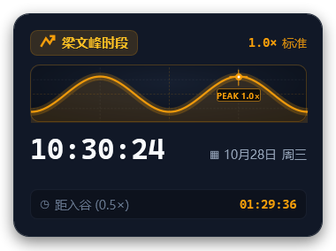
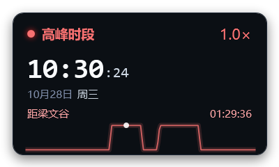
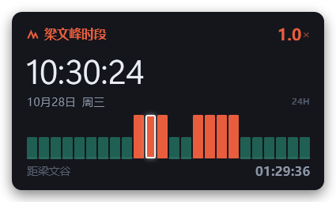
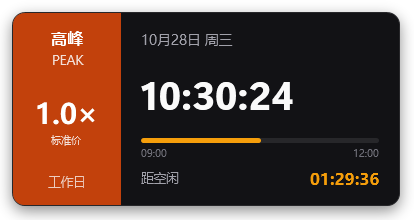

<p align="center">
  
</p>

<h1 align="center">DeepSeek 时段挂件</h1>

> Windows 桌面小挂件：一眼看清现在是 DeepSeek 的「高峰时段」还是「空闲时段」，以及还有多久切换。23 套界面可切换，只依赖 Windows 自带的 PowerShell 5.1 + WPF，**无第三方依赖**。
>
> 非 DeepSeek 官方项目。

<p align="center">
  <a href="https://github.com/ChenChen913/deepseek-time-widget/actions/workflows/test.yml"></a>
  <a href="LICENSE"></a>
  <a href="#快速开始"></a>
</p>

<div align="center">
<table>
  <tr>
    <td align="center"><b>C3 · 刻度带</b><br></td>
    <td align="center"><b>F1 · 峰谷示波器</b><br></td>
  </tr>
  <tr>
    <td align="center"><b>D1 · 示波器</b><br></td>
    <td align="center"><b>D3 · K 线</b><br></td>
  </tr>
  <tr>
    <td align="center"><b>C6 · 色块</b><br></td>
    <td align="center"><b>E4 · 双色瑞士分屏</b><br></td>
  </tr>
  <tr>
    <td align="center"><b>E2B · 中文余量 HUD</b><br></td>
    <td align="center"><b>默认界面</b><br></td>
  </tr>
</table>
</div>

> 8 张都是挂件实际渲染，不是网页设计稿，统一拍在 2026-10-28 10:30:24 周三高峰。全部 23 套截图在 [design/previews](design/previews)，右键「界面方案」可随时切换。

## 功能

- **实时状态与倒计时**：每秒刷新高峰、空闲、周末和法定节假日，自动跨过午休、夜间、周末和假期。
- **北京时间**：始终按 UTC+8 计算，与本机时区无关，显示日期、星期和节日名称。
- **两种时间轴**：默认等方案显示当天 00:00–24:00 时段轴；E2 / E2B 的 8 段 HUD 按当前连续段计算，跨周末不重置。
- **23 套界面**：右键切换，选中即生效并写入 `settings.json`，不需要重启。
- **桌面集成**：单实例唤起、托盘显示与隐藏、置顶、开机自启、快捷方式管理。
- **节假日数据**：内置 2025、2026 年，支持联网更新和缺失年份降级提示。
- **无依赖**：Windows 10 / 11 自带 Windows PowerShell 5.1 和 WPF。

## 界面

默认界面是深色玻璃卡片，右键「界面方案」可切换全部 23 套布局。方案分组如下，都是挂件内真实可用的界面：

`默认；A1/A3/A5/A6；B1/B3/B4/B5；C1/C2/C3/C4/C6；D1/D3/D6；E2/E2B/E3/E4/E5；F1`

23 张实拍在 `design/previews/scheme-*.png`，由挂件自身的离屏渲染生成。`design/*.html` 是早期网页评审稿，不代表实际界面。

## 计费规则

> 空闲时段价格为高峰时段价格的一半。北京时间周一至周五（不含中国法定节假日）9:00–12:00、14:00–18:00 为高峰时段；其余时段，包括周末及中国法定节假日全天均为空闲时段。

- 09:00:00 进入高峰，12:00:00 进入空闲，14:00:00 进入高峰，18:00:00 进入空闲。
- 始终按 UTC+8 计算，与本机时区无关。
- 严格按官网字面规则：周末即使遇到调休上班日也按空闲时段处理。

## 快速开始

**安装包（推荐）**

到 [Releases](https://github.com/ChenChen913/deepseek-time-widget/releases/latest) 下载 `DeepSeekClock-Setup-v*.exe`，双击按向导安装。当前用户安装，不需要管理员权限，自动创建快捷方式，可选开机自启和安装完成后启动。

**便携版**

下载 `DeepSeekClock-Portable-v*.zip`，解压后双击 `DeepSeekClock.exe`。首次启动会自动创建快捷方式，可在右键菜单管理。

**源码运行**

克隆仓库后双击 `启动挂件.vbs`；VBScript 被禁用时改用 `启动挂件.cmd`。

要求：Windows 10 / 11，无需安装任何运行时。

### 安装与卸载

- 安装版默认在 `%LOCALAPPDATA%\Programs\DeepSeekClock`，卸载入口在“设置 > 应用 > 已安装的应用”。
- 设置、窗口位置和联网更新的节假日数据保存在 `%APPDATA%\DeepSeekClock`。升级保留，卸载默认保留，可按提示一并删除。
- 未签名的发布可能在 Windows 上提示“未知发布者”，请对照 Release 里的 `SHA256SUMS.txt` 校验文件。

## 节假日数据

- 内置 2025 年 28 天、2026 年 33 天放假日，来源国务院办公厅通知，并与 timor.tech、NateScarlet/holiday-cn 逐日核对。
- 右键「联网更新节假日数据」抓取当年和次年数据，保留旧年份与 `makeupWorkdays` 等字段，自动备份 `.bak`；日常运行不联网。
- 更新结果写入 `%APPDATA%\DeepSeekClock\holidays.json`，启动时优先读取，只读安装目录也能正常更新。
- 2027 年安排截至 2026-11-02 尚未发布；数据缺失时自动按星期判断，并在日期行提示「数据待更新」。

## 文件结构

```
├─ DeepSeekClock.ps1      # WPF 主程序
├─ holidays.json          # 节假日数据
├─ lib/                   # 时段逻辑与 23 套方案引擎
├─ launcher/ installer/   # EXE 启动器与 Inno Setup 安装包
├─ test/                  # 核心、方案、渲染、安装包测试
├─ tools/                 # 图标、截图、构建发布
├─ design/previews/       # 23 套方案实际截图
├─ research/              # 节假日数据核验、DSH 调研
└─ .github/workflows/     # CI 与 Release
```

## 开发与测试

测试覆盖：核心 85 项、方案数据 872 项、界面渲染 93 项、安装包冒烟 21 项。

```powershell
# 核心、方案、渲染测试
powershell.exe -NoProfile -ExecutionPolicy Bypass -File .\test\Test-Core.ps1
powershell.exe -NoProfile -ExecutionPolicy Bypass -File .\test\Test-Schemes.ps1
powershell.exe -NoProfile -ExecutionPolicy Bypass -File .\test\Test-Render.ps1

# 安装包冒烟（先退出正在运行的挂件）
powershell.exe -NoProfile -ExecutionPolicy Bypass -File .\test\Test-Installer.ps1 -TestAutoStart

# 构建安装包和便携版（需要 Inno Setup 6）
powershell.exe -NoProfile -ExecutionPolicy Bypass -File .\tools\build-release.ps1 -Version 1.2.0

# 查看当前状态（不弹界面）
powershell.exe -NoProfile -ExecutionPolicy Bypass -File .\DeepSeekClock.ps1 -PrintStatus
```

Release 工作流在推送 `v*` 标签时构建、跑安装包冒烟并上传资产；未签名时默认标记为预发布。代码签名、证书方案和发布检查见 [TODO.md](TODO.md)。

## 相关文档

- [DSH 插件调研](research/dsh-plugin.md)：把时段状态放进 DSH 会话标题栏的方案。
- [后续任务与实施方案](TODO.md)：代码签名、节假日回退源、2027 数据、便携包测试、兼容性回归和发布清单。

## 说明

- 本工具只是本地时间计算器，不调用 DeepSeek 接口，也不代表官方计费结果。
- 未内置任何账号信息或密钥。
- 图标与界面均为本项目自绘。

## License

[MIT](LICENSE) © 2026 ChenChen913
