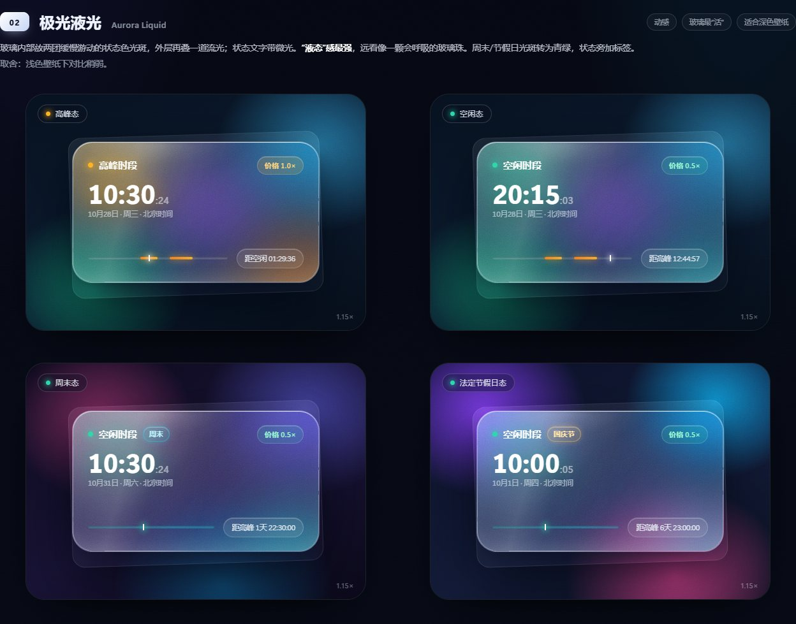
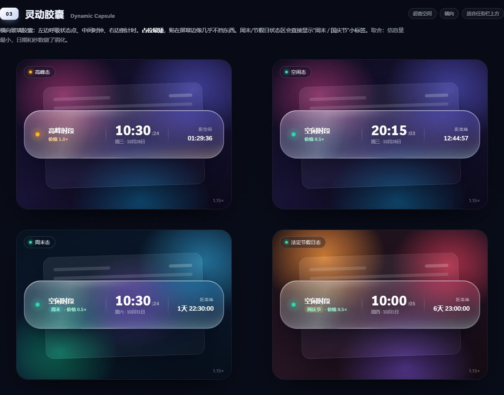
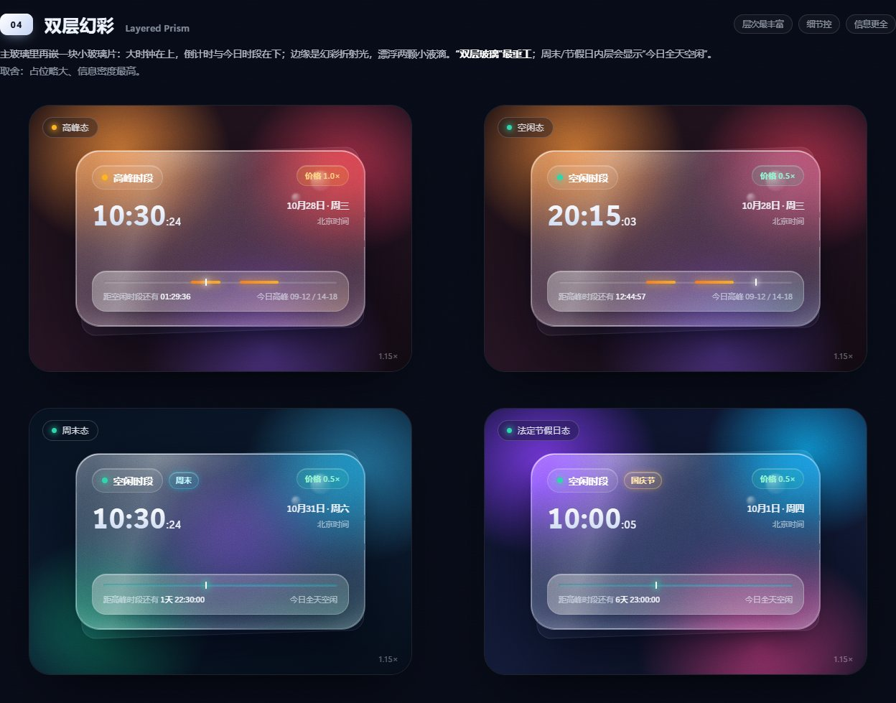
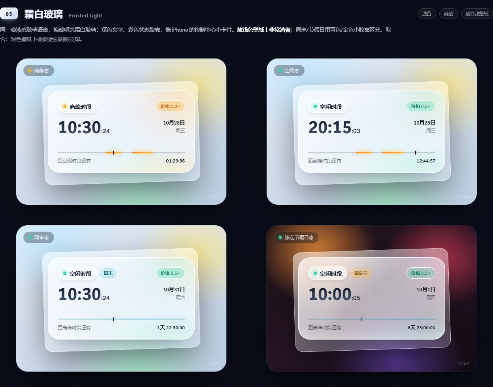
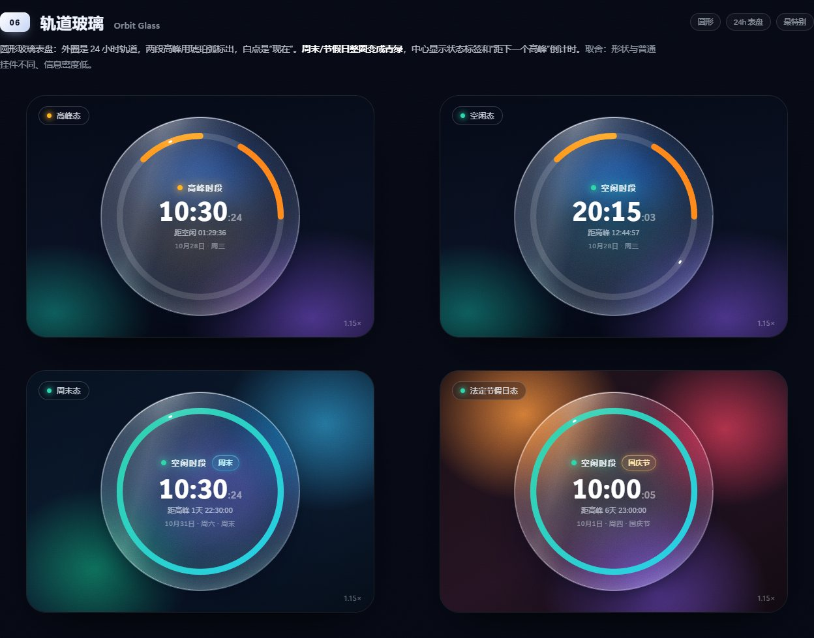

# DeepSeek 时段挂件

> Windows 桌面小挂件：一眼看清现在是 DeepSeek 的「高峰时段」还是「空闲时段」。液态玻璃视觉，Windows 自带 PowerShell 5.1 + WPF，**无第三方依赖**。
>
> 非 DeepSeek 官方项目。

[](https://github.com/ChenChen913/deepseek-time-widget/actions/workflows/test.yml)
[](LICENSE)
[](#快速开始)

<p align="center">
  
  
</p>

## 功能

- **实时状态**：每秒刷新，高峰 / 空闲两种配色（色点、标题、价格徽标、时间轴同步变色）
- **北京时间和日期**：大号时钟 + 星期、日期、法定节假日名称
- **今日时段轴**：两个高峰窗口用琥珀色标出，白线是当前时间位置；周末/法定节假日整条变成流动青绿（全天空闲）
- **切换倒计时**：自动跨过午休、夜间、周末和法定节假日，跨天显示「N天 HH:MM:SS」
- **液态玻璃卡片**：透明圆角浮窗 + 光影 + 状态光晕，置顶显示、可拖动、位置自动记忆
- **单实例**：重复启动不会开第二个窗口，而是把已在运行的挂件叫回前台
- **托盘图标**：左键单击显示 / 隐藏挂件，卡片被遮挡时也有入口
- **右键菜单**：自绘圆角玻璃面板，替代系统默认菜单外观
- **界面方案可切换**：右键 →「界面方案」可在 **22 套外观**之间随时切换（默认界面 + 21 个方案），选中即生效、勾选状态与「当前」标题同步；选择写进 `settings.json`，下次启动沿用。同进程切换会重建布局（通用卡片 / 胶囊 / 表盘 + 9 套专属模板），不必重启
- **日期行随布局自适应**：周末不再额外标「· 周末」（周几那行已经写明周六 / 周日）；节假日名在卡片布局里改放到周几那一行，在胶囊 / 表盘布局里才跟在日期后面 —— 卡片布局的日期列被大号时钟挤在右边，硬塞节日名会把「10月31日」截成「10月31…」
- **开机自启**：右键菜单勾选即可
- **节假日数据**：内置 2025、2026 年中国法定节假日（共 61 天），支持右键联网更新
- **无依赖**：只需 Windows 10/11 自带的 Windows PowerShell 5.1

## 视觉升级方案（6 选 1，待实现）

`design/design-options.html` 是 6 个液态玻璃 UI 方向的网页预览（下载后用浏览器打开，包含真实背景模糊、流光、状态光晕等效果），每个方案都展示了 **高峰 / 空闲 / 周末 / 法定节假日** 四种状态。

> 在线预览（GitHub Pages）：<https://chenchen913.github.io/deepseek-time-widget/design/design-options.html>

**全部方案总入口**：`design/all-schemes.html` 收着筛过一轮后的 **25 个方案**——「默认界面」的 4 个状态作基准（L1–L4），加上 7 个方向里留下的 21 个（A1 / A3 / A5 / A6、B1 / B3 / B4 / B5、C1–C4 / C6、D1 / D3 / D6、E2–E5 / F1）。编号沿用各组原来的序号，删掉的编号直接空着，方便对回原稿。**这 21 个方案都已实现进挂件本体**，可直接右键切换，不是纸面预览。

页面有三个页签：**总览**（卡片网格，可标「已看 / 候选」）、**逻辑映射**（把时间显示、峰谷切换、周末节假日换算、特效、窗口尺寸五条底层机制逐条对照 25 个方案，给出落地难度与主要风险）、**逐项**（右侧直接渲染原稿，`←` `→` 连续翻阅）。A1 详情页还能切「初版 / 展开版」。

| 编号 | 方向 | 一句话 |
| --- | --- | --- |
| 01 | 极简流光 | 很薄的一层玻璃 + 顶部折射高光，时钟为主角，最克制耐看 |
| 02 | 极光液光 | 玻璃内两团缓慢游动的状态色光斑，最“液态” |
| 03 | 灵动胶囊 | 横向胶囊形，占位最矮，适合贴在屏幕边缘 |
| 04 | 双层幻彩 | 主玻璃里再嵌一块小玻璃片，层次最多、信息最全 |
| 05 | 霜白玻璃 | 明亮霜白玻璃 + 深色文字，适合浅色壁纸 |
| 06 | 轨道玻璃 | 圆形 24 小时表盘，外圈标出高峰窗口和白点“现在”，最特别 |

预览（完整动态效果以 HTML 为准）：

| 01 | 02 | 03 |
| --- | --- | --- |
|  |  |  |
| **04** | **05** | **06** |
|  |  |  |

> 上面 6 张图是最初的方向稿；最终落地的是审查台里的 21 个方案 + 默认界面，均已实现并可在右键菜单里切换。每个方案的实际挂件截图见 `design/previews/scheme-*.png`（由 `tools/capture-schemes.ps1` 生成）。

## 计费规则（来自 DeepSeek 官网）

> 空闲时段价格为高峰时段价格的一半。北京时间周一至周五（不含中国法定节假日）9:00 - 12:00、14:00 - 18:00 为高峰时段；其余时段，包括周末及中国法定节假日全天均为空闲时段。

挂件的实现约定：

| 项目 | 规则 |
| --- | --- |
| 高峰时段 | 北京时间周一至周五 09:00-12:00、14:00-18:00（不含法定节假日） |
| 空闲时段 | 其余所有时间，包括周末、法定节假日全天，价格 = 高峰的一半 |
| 分钟边界 | 09:00:00 进入高峰；12:00:00 进入空闲；14:00:00 进入高峰；18:00:00 进入空闲 |
| 调休 | 严格按官网字面规则：周末即使遇到“调休上班日”也按空闲时段处理 |
| 时区 | 始终按北京时间（UTC+8）计算，与本机系统时区无关 |

## 快速开始

**方式一：下载即用（推荐）**

到 [Releases](https://github.com/ChenChen913/deepseek-time-widget/releases/latest) 下载 `DeepSeekClock-v*.zip`，解压到任意固定目录，双击 **`启动挂件.vbs`** 即可。解压后请保持文件夹结构完整。

**方式二：从源码运行**

1. 克隆或下载本仓库；
2. 双击 **`启动挂件.vbs`**（静默启动）；如果系统禁用 VBScript，可双击 **`启动挂件.cmd`**；
3. 挂件会出现在屏幕右下角，左键拖动可移动，右键打开菜单：窗口置顶 / 开机自动启动 / 联网更新节假日数据 / 打开程序文件夹 / 创建桌面快捷方式 / 使用说明 / 退出。

要求：Windows 10 / 11，无需安装任何运行时。

## 节假日数据与更新

- 内置 `holidays.json`：**2025 年 28 天、2026 年 33 天**放假日（来源：国务院办公厅节假日安排通知，并与 timor.tech、NateScarlet/holiday-cn 逐日交叉核对）；
- 右键「联网更新节假日数据」会抓取当年 + 次年数据并合并（保留旧年份和 `makeupWorkdays` 等字段，自动备份 `.bak`）；日常运行不联网；
- 更新结果写入 `%APPDATA%\DeepSeekClock\holidays.json`，启动时优先读取它，因此程序放在 `Program Files` 等只读目录也能正常更新；
- 2027 年安排截至 2026-10-28 尚未发布；数据缺失时挂件自动降级为“只看星期几”，并在日期行提示「数据待更新」；
- 也可手动编辑 `holidays.json`。

## 文件结构

```
├─ 启动挂件.vbs            # 静默启动器
├─ 启动挂件.cmd            # 备用启动器
├─ DeepSeekClock.ps1       # 主程序（WPF 界面 + 交互）
├─ holidays.json           # 节假日数据
├─ lib/
│  ├─ DeepSeekTime.ps1     # 时段判断核心逻辑（纯函数）
│  ├─ Schemes.ps1          # 界面方案引擎：22 份配方 + 3 套通用布局 + 15 个装饰器
│  └─ SchemesPro.ps1       # 13 套专属布局（A3/B3 胶囊、A6/B4 表盘、C3 刻度带、示波器/液晶/瑞士分屏/野兽派/半谷/K线/色块/HUD/圆表）+ 10 个专属装饰器
├─ test/
│  ├─ Test-Core.ps1        # 单元测试（79 项断言）
│  └─ Test-Schemes.ps1     # 界面方案数据校验（835 项断言）
├─ tools/
│  ├─ make-icon.ps1        # 重新生成图标
│  ├─ capture-schemes.ps1  # 逐方案离屏截图（-Schemes a1,c6…）
│  └─ build-scheme-gallery.py  # 生成 design/all-schemes.html（方案清单在文件里）
├─ assets/                 # 图标
├─ docs/                   # 预览截图
├─ design/                 # 视觉方案 HTML（all-schemes.html 为 25 个方案终选审查台；live-v1-states.html 是默认界面四态基准）
├─ research/
│  └─ notes.md             # 节假日数据来源与三方核验记录
├─ .github/workflows/      # CI：推送后自动跑单元测试
├─ LICENSE                 # MIT
└─ README.md
```

## 开发与测试

```powershell
# 单元测试
powershell.exe -NoProfile -ExecutionPolicy Bypass -File .\test\Test-Core.ps1

# 界面方案数据校验
powershell.exe -NoProfile -ExecutionPolicy Bypass -File .\test\Test-Schemes.ps1

# 命令行查看当前状态（不弹界面）
powershell.exe -NoProfile -ExecutionPolicy Bypass -File .\DeepSeekClock.ps1 -PrintStatus

# 指定时刻（排查边界 / 生成截图）
powershell.exe -NoProfile -ExecutionPolicy Bypass -File .\DeepSeekClock.ps1 -PrintStatus -PreviewTime 2026-10-01T10:00:00+08:00
```

## 说明

- 本工具只是本地时间计算器，不调用 DeepSeek 接口，也不代表官方计费结果；
- 未内置任何账号信息或密钥；
- 图标与界面均为本项目自绘。

## License

[MIT](LICENSE) © 2026 ChenChen913